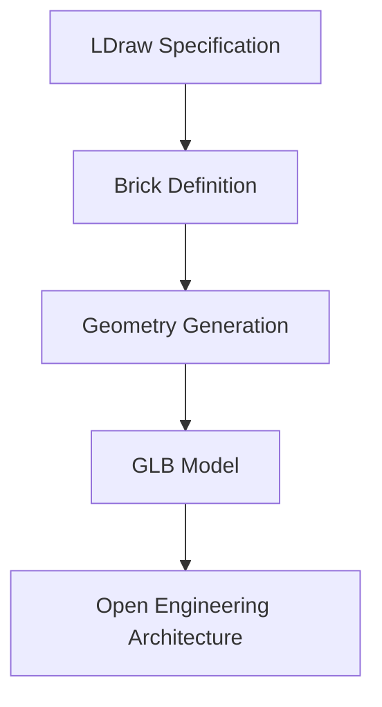

# Open Engineering Bricks

**Building engineering understanding, one brick at a time.**

## Overview

Open Engineering Bricks provides reusable building blocks for creating digital engineering models.

## Capabilities

| Capability | Description |
|------------|-------------|
| Brick Definitions | LDraw-based specifications |
| Model Generation | Transform bricks into GLB models |
| Composition | Combine bricks into larger structures |
| Integration | Publish reusable engineering artifacts |

## Architecture

## Getting Started

1. Explore the available brick definitions.
2. Select the required LDraw components.
3. Generate the corresponding digital models.
4. Integrate the models into your application.

## Related Projects

- [Open Engineering Architecture](https://github.com/open-engineering-architecture)
- [Open Engineering Bricks](https://github.com/open-engineering-bricks)

---

**Open Engineering — Building the future, one brick at a time.**
